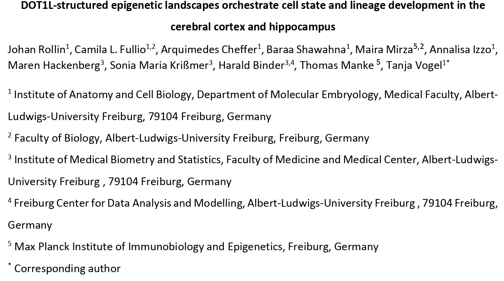
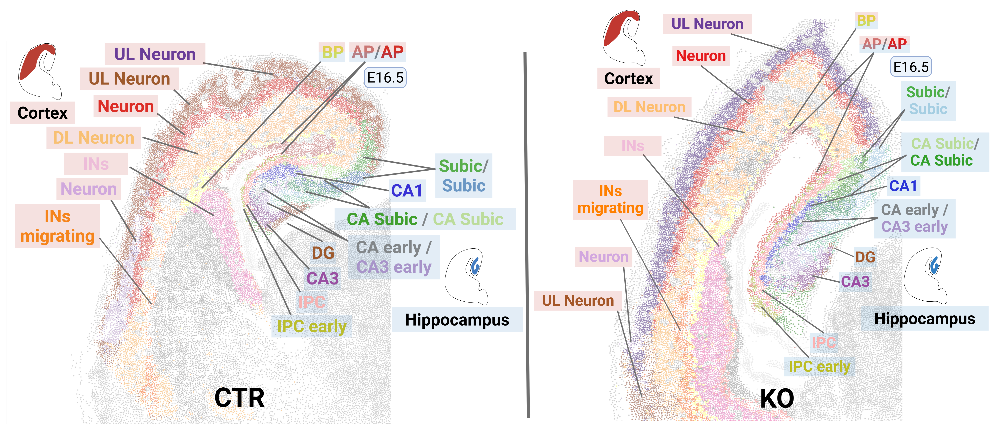
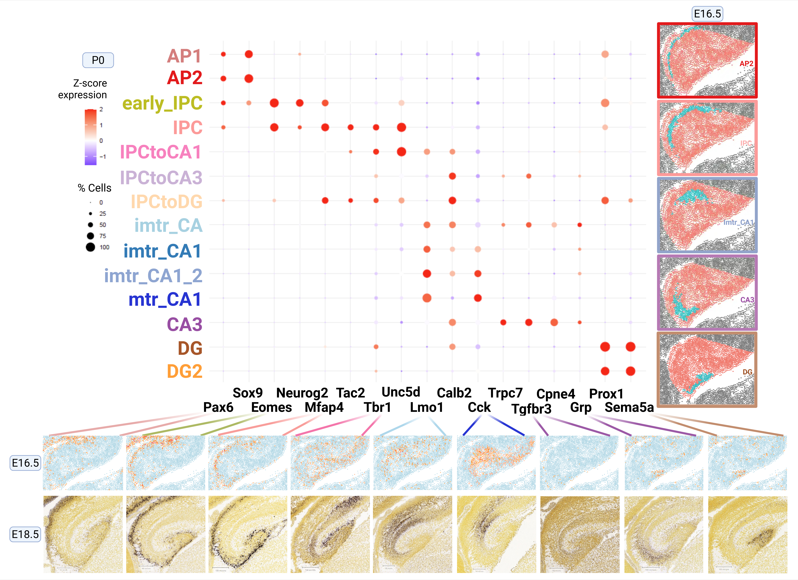

<p align="center">
    
</p>
<p align="center">
        <a href="https://github.com/johrollin/Dot1l_hippocampus/releases">
            
        </a>
        <a href="https://github.com/johrollin/Dot1l_hippocampus/blob/master/LICENSE" alt="License">
            
        </a>
        <a href="https://github.com/johrollin/Dot1l_hippocampus/graphs/contributors" alt="Contributors">
            
        </a>     
        <br/> 
        <a href="soon">
          
        </a>           
        <a href="https://doi.org/10.5281/zenodo.24439433"></a>

    
 </p>

# About The Project
Mechanisms governing the development of hippocampal progenitors towards pyramidal or dentate granule neurons remain incompletely understood. Conditional deletion of Dot1l in mice (DOT1L-KO) disrupts the development of both the cerebral cortex and hippocampus. This allows us to compare developmental trajectories in these two regions.
DOT1L orchestrates expression and chromatin accessibility of key transcription factors (TFs) controlling hippocampus as well as cortical development. Trajectory analysis, gene expression program (GEP) and gene regulatory network (GRN) inference demonstrate that DOT1L-KO re-organises GRN architecture across progenitor-to-neuron trajectories in both structures. Exploring the epigenetic regulation of CA lineage trajectory, we show that DOT1L-KO favours premature neuronal differentiation and maturation by decreasing Tcf4, Zbtb20, and Lhx2 expression, the latter of which in a SOX2-dependent mechanism. We further show that Bcl11b- and Sox5-marked neuronal identities increased between control and mutant brains. Our data reveal an amplifying interdependency of Bcl11b and Sox5 expression, in which SOX5 limits Bcl11b, and BCL11B limits Sox5 expression, through accessibility changes at DOT1L-sensitive chromatin regions. Moreover, our data link subiculum-fated neurons to CA1 and CA3 field identities in the embryonic hippocampus, involving the DOT1L-BCL11B-SOX5 axis. This predicted trajectory can contribute to the overrepresented subiculum cells on the expense of CA neurons upon DOT1L-KO, and unravels at least dual embryonic origin of CA1 and CA3 field neurons. Together, our data establish DOT1L as a key upstream epigenetic regulator of important TFs, structuring the cerebral cortex and hippocampus. DOT1L synchronises chromatin accessibility and GRN dynamics to control cell-type-specific gene activity and cell lineage identities.


For more information: <a href="https://doi.org/XX"> see article</a>     

<p align="center">
    
</p>
        <br/> 

<p align="center">
    
</p>
# Getting Started
## Installation

```shell
git clone https://github.com/johrollin/Dot1l_hippocampus.git

cd Dot1l_hippocampus/
```

## Contributing
This work was part of the <a href="https://www.meinbio.uni-freiburg.de/what-is-meinbio-1">MeInBio</a> and  <a href="https://www.smalldata-initiative.de">Small data</a> projects.

